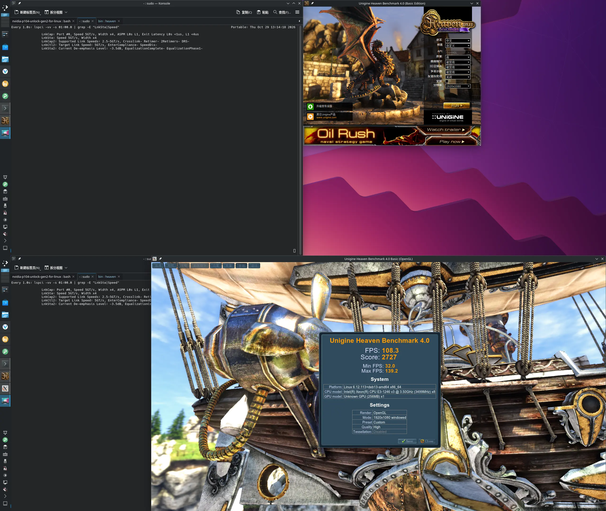

# NVIDIA P104-100 —— Linux 下解锁 PCIe Gen2 x4

> ## 🧪 参考项目说明

> 本项目是一份**实验记录 + 可复现的参考实现**，供后来者查阅和参考，
> 不是有维护承诺的产品。补丁针对特定驱动版本，换版本需自行重新定位。

---

> ## ⚠️ AI 生成内容声明
>
> **本项目绝大部分内容由 AI Agent 生成**，包括但不限于：
> 全部脚本、内核模块源码、逆向分析、文档，以及**对 NVIDIA 闭源驱动的二进制补丁**。
>
> **使用者必须知道的事：**
>
> 1. **没有任何担保。** 按「现状」提供，不承诺正确性、安全性、适用性。
>    使用后果（硬件损坏、数据丢失、系统不可用、驱动授权/保修问题）**由使用者自行承担**。
> 2. **这是闭源驱动的二进制补丁。** 修改 `nvidia.ko` 里的机器码属于非官方行为，
>    可能违反 NVIDIA 的许可条款。它绕过的是驱动按 vBIOS 声明限制链路的逻辑。
> 3. **测试期间这台设备被打挂过多次**（`ZOMBIE` / `Xid 79 GPU has fallen off the bus`），
>    每次只能整机重启恢复。主要成因：
>    - 用户态 `mmap` 写 BAR0（链路动态时，**2/2 必挂**）
>    - 写 `0x8C040` 的时序不对（训练未完成就写 SPEED）
>    - 反复 reload 驱动导致的"状态锁死"（声明卡在 Gen1，只能重启）
>
>    这些教训全部写进了 `docs/安全纪律.md`，**动手前请务必读完**。
>    仓库里那些**故意归档**的失败实验（`legacy/`、`history/pcie-gen2/*.py`）
>    就是踩坑的记录，不要直接跑。
> 4. **只在一台设备上验证过**：P104-100 / Debian 13 / kernel 6.12.113 / NVRM 580.178.04。
>    其他内核版本、其他 Pascal 卡、其他驱动版本**均未验证**。
> 5. AI 会产生看似合理但实际错误的结论。本项目文档里明确标注了
>    **哪些结论被后续实验推翻**（见 `docs/实验历程.md` 的"走过的死路"），
>    请以**你自己的实测**为准，不要盲信任何文字。
>
> **建议**：先在一个不重要的环境里完整走一遍 `docs/安全纪律.md`，
> 确认你理解每一步的风险，再动生产机。

把 NVIDIA P104-100（Pascal，`10de:1b87`）在 Linux 下的 PCIe 链路从 **Gen1 x4（2.5GT/s，~0.78 GB/s）**
解锁到 **Gen2 x4（5.0GT/s，~1.56 GB/s）**，带宽翻倍。

已在 Debian 13 / kernel 6.12.113 / NVRM 580.178.04 上验证：
**353 轮 CUDA 上下文零降级、Xid 0、pinned H2D 1.563 GB/s / D2H 1.705 GB/s。**

---

## 按驱动版本复现（先看这个）

所有补丁与内核模块都按**驱动版本**归档在 `drivers/` 下，目前只有
`580.178.04`（唯一完整验证过的组合）。**在版本目录里按编号顺序执行即可**，在执行前先行执行一下模块编译，即到对应 kernel 目录下执行make（脚本自动编译可能出错），
不必回仓库根：

```bash
cd drivers/580.178.04

# 00 前置（可选）：解除受限 SKU —— 只影响帧率/功耗，与 Gen2 无关
sudo bash 00-whitelist.sh check
sudo bash 00-whitelist.sh apply
#   → 改完必须重建模块：cd /usr/src/nvidia-580.178.04 && sudo make -j$(nproc)

# 01 必做：修补 nvidia.ko，让驱动不再把速率降回 Gen1（2 字节）
sudo bash 01-gen2-patch.sh check
sudo bash 01-gen2-patch.sh apply
#   → 改完必须重载 nvidia 模块，或直接重启

# 02 必做：加载内核模块并把链路推到 Gen2
sudo bash 02-gen2-push.sh status
sudo bash 02-gen2-push.sh start
```

三个脚本都支持反向操作，**还原时反向依次执行**：

```bash
sudo bash 02-gen2-push.sh stop
sudo bash 01-gen2-patch.sh revert
sudo bash 00-whitelist.sh revert    # 如果第 0 步做过
```

> ⚠ 每一步重载/重启前，先确认没有程序占用 GPU：
> `fuser -v /dev/nvidia*`。有输出就先关掉（浏览器最常见），
> 否则 `unbind` 会卡死内核、`kill -9` 无效，只能整机重启。

每个版本的完整说明（偏移表、原理、验证数据）见
`drivers/<版本>/README.md`。想换到别的驱动版本，看 `drivers/README.md`
的定位方法 —— 偏移跟版本强绑定，**不能照搬**。

### 不想分步？

仓库根有一套一体化工具，干的是同一件事（改同一批字节），按你习惯选一条路走：

```bash
sudo bash bin/20-install.sh     # 打补丁 + 编译模块 + 推送，全自动
```

展开版（编译、自检、验证、回滚）见下面的「快速开始」。
⚠ 两条路**不要混着重复打** —— 脚本会检测状态并拒绝已打过的。

### heaven 测试（这里的针对 SKU 只 patch 用户态的每批次延迟，没有 patch 内核解除 SKU 限制）
- Gen1 测试：
  
- Gen2 测试：
  

---

## 为什么需要解锁

P104 的 vBIOS 把 PCIe 能力声明限制在 Gen1，驱动据此把链路初始化为 2.5GT/s。
更麻烦的是：**驱动会在每次 `cuInit` 时主动把链路降回 Gen1**。

静态分析定位到这条路径（`_nv017105rm` 就是驱动自己的 `set_link_speed(mode)`）：

```
rm_init_adapter+0xcd          ← 每次 cuInit 都走这里
  → _nv017755rm+0x98          ← if (mode == 当前速率) return;
    → _nv017105rm(mode=1)     ← mode 1/2/3 = Gen1/Gen2/Gen3
        mode=1 → or $0x80000 → 写 0x8C040.SPEED=2 → 链路 2.5GT/s
```

所以有两条路：
- **事后救**（旧方案）：链路掉了再检测、再拉回 —— 恢复要 3.8 秒，期间带宽腰斩
- **不降**（本方案）：把那个 `mode=1` 在入口拦掉 —— 链路常驻 Gen2

---

## 方案组成

两部分，缺一不可：

### ① 2 字节补丁（核心）

把 `_nv017105rm` 入口的 mode 白名单从 `{1,2,3}` 收窄成 `{2,3}`：

```asm
- 127d66: 8d 42 ff     lea  -0x1(%rdx),%eax    ; eax = mode - 1
- 127d81: 83 f8 02     cmp  $0x2,%eax
+ 127d66: 8d 42 fe     lea  -0x2(%rdx),%eax    ; eax = mode - 2
+ 127d81: 83 f8 01     cmp  $0x1,%eax
  127d84: 0f 87 ...    ja   1280c8             ; 这条不动
```

新判据 `(mode-2) > 1`（无符号）：

| mode | mode-2 | >1? | 结果 |
|---|---|---|---|
| 1 | `0xFFFFFFFF`（下溢） | 是 | **bail** ← 唯一的行为变化 |
| 2 | 0 | 否 | 继续 → Gen2 |
| 3 | 1 | 否 | 继续 → Gen3 |
| ≥4 | ≥2 | 是 | bail（**与原逻辑完全等价**） |

bail 跳到 `1280c8`，那是函数唯一的 return 点，返回 `%r12d` ——
它在入口被 `xor` 清零，所以返回 **0 = CUDA_SUCCESS**。驱动认为设置成功，不报错不重试。

**只改 2 个字节，其余指令、其余分支、其余 mode 全部不变。**

### ② gen2kr 内核模块（只负责首次推送）

补丁只让驱动"不再降"，但链路还得先升上去。为此需要：
- 解锁端点声明（`0x8841C` 等），使 `LINK_CAP2` 从 `0x02` 变成 `0x06`
- 写 `0x8C040.SPEED=1`（5.0GT/s）
- 两端 `LNKCTL2` TLS=2，从根端口 Retrain

**时机很关键**：必须在 `nv_pci_probe` 返回的瞬间做，否则 RM 已按 Gen1 完成内部初始化，
之后再改链路只会得到"链路 Gen2 但带宽还是 Gen1"（内部数据面仍按 Gen1 配）。

`gen2kr.ko` 用 `kretprobe` 挂在 `nv_pci_probe` 上，就在那一刻推送。

它同时带一个守卫（每 200ms 读一次 `LNKSTA`），但**补丁在位时守卫应零动作** ——
守卫只是安全网（补丁会随驱动升级丢失，那时守卫能把链路拉回来）。

---

## 验证记录（2026-10-29 从零复现）

在**干净原厂状态**（重启后 `md5=7f6805ed…`、无 gen2kr、链路 2.5GT/s）完整跑了一遍：

| 步骤 | 结果 |
|---|---|
| `build.sh` | minictx / bwtest2 / gen2kr.ko(410440) 全部编译成功 |
| `10-check.sh` | 正确报出原厂状态：`CAP2=0x0002 LNKSTA=1 TLS=1 SPEED=2 MAXSPD=1` |
| `20-install.sh --dry-run` | md5 未变（零改动确认） |
| `20-install.sh` | **一次成功** → `CAP2=0x0006 LNKSTA=2 TLS=2 SPEED=1 MAXSPD=2` |
| `30-verify.sh --full` | A 带宽 **1.562/1.708 GB/s**、B 5 轮稳定、C 补丁独立性 通过 |

### 复现过程中修掉的一个 bug
`20-install.sh` 原本用「`CAP2=0x0002` + `TLS=1` + Gen1」判断"驱动侧锁死态"，
但这**正是原厂未解锁的正常样子** —— 干净机器重启后必然触发误报。

改成用 `is_stuck()`（在 `bin/_common.sh`）判断真正的锁死态特征 ——
**解锁位写过了但没生效**：

```
0x8841C 的 bit15|bit13|bit11 已置位（= 写过解锁，原厂 0xc0b40500 → & 0xA800 == 0）
但 CAP2 仍是 0x0002（= 没锁存成功）
且链路仍是 Gen1
```

## ⚠ 重启后会回到 Gen1

| 项 | 重启后 |
|---|---|
| 2 字节补丁（在 `nvidia.ko` 里） | **保留** |
| `gen2kr`（手动 insmod，无 service） | **丢失** |

补丁只负责"不再降级"，不负责"把链路升上去"。上电时端点声明是 Gen1
（`LCAP2=0x02`），没人解锁、没人推送，链路就停在 2.5GT/s。

实测（带补丁重启、无 gen2kr）：
```
LNKSTA=1  LCAP2=0x0002  TLS=1  0x8841C=0xc0b40500
带宽 pinned H2D 0.779 / D2H 0.855 GB/s     ← Gen1 水平
```

### 补齐只要一条命令（★ 不用重载 nvidia）

```bash
# 在仓库根目录执行（脚本自己算路径，不依赖安装位置）
sudo bash bin/push.sh
```

它等价于手动做这三步（★ 注意 `gen2kr.ko` 是编译产物，先跑过一次 `bin/build.sh`）：

```bash
sudo insmod build/gen2kr.ko                  # 相对仓库根目录
sudo sh -c 'echo 0000:01:00.0 > /sys/bus/pci/drivers/nvidia/unbind
            sleep 1
            echo 0000:01:00.0 > /sys/bus/pci/drivers/nvidia/bind'
```

> 如果把仓库放在别处，`bin/` 里的脚本不需要改 —— 它们用
> `$(dirname $0)/..` 自己推导根目录。只有上面这段**手写**命令需要用你
> 实际的仓库路径。

实测日志（reports/201）：
```
[fast] 直接写 SPEED=1，原 20045800 → 20045800
[push] 起始 cap2=00000006 config=c0b48d00 lnkcfg0=20045800
[push] 写完 cap2=00000006 config=c0b4ad00 lnkcfg0=20045800
★ SUCCESS Gen2 LNKSTA=1042
```
→ 链路 5GT/s，pinned H2D **1.561** / D2H **1.708 GB/s**，**nvidia 全程未被卸载/重载**。

### 什么时候才需要重载 nvidia

| 场景 | 要重载吗 |
|---|---|
| 刚 `patch_no_gen1.py apply`（.ko 变了） | **要** —— 不重载内核跑的还是旧代码 |
| 重启后（补丁早在 .ko 里） | **不要** —— `push.sh` 就够 |
| 补丁丢失后重新 apply | **要** |

`bin/20-install.sh` 会自动判断（比对 apply 前后 md5）：
- `.ko` 变了 → `✓ 补丁是新写入的 ⇒ 需要重载`
- `.ko` 没变 → `✓ 补丁本来就在（.ko 未变）⇒ 不需要重载`

也可以强制：`sudo bash bin/20-install.sh --no-reload`

### 自动化三选项（按侵入性）

| 选项 | 做法 | 侵入性 |
|---|---|---|
| **A. 手动**（当前） | 开机后跑 `bin/push.sh`（约 3 秒，不重载 nvidia） | 无 |
| B. modprobe softdep | 给 gen2kr 加 init 时推送 + `/etc/modprobe.d/nvidia.conf` 写 `softdep nvidia post: gen2kr` | 低。**未实现、未验证** |
| C. systemd service | 装 `drivers/<版本>/kernel/<内核>/gen2kr.service` | 高（用户要求不装） |

详见 `docs/部署与持久化.md`。

## 快速开始（仓库根的一体化工具）

> 与上面的分步脚本是**两条等价的路**：
> 分步脚本（`drivers/<版本>/00/01/02`）按阶段拆开，适合看清每一步做了什么；
> 这里的 `bin/` 是一体化封装，适合按顺序跑完。
> 两者改的是同一批字节，**不要混着重复打**（脚本会检测状态并拒绝）。

```bash
# 先 clone 或解压到任意目录，然后 cd 进去
git clone https://github.com/WJNKAC/nvidia-p104-unlock-gen2-for-linux
cd nvidia-p104-unlock-gen2-for-linux
# 后面所有命令都在这个目录里执行，用相对路径

# 1) 编译
#    ★ 必须用普通用户，不要 sudo —— 权限不对时 root 编译产物会归 root
#    ★ 内核模块必须在【跑 P104 的那台机器】上编（要匹配它的 /lib/modules/$(uname -r)）
bash bin/build.sh

# 2) 自检（纯只读，不改任何东西）
sudo bash bin/10-check.sh

# 3) 先看计划，确认无误（dry-run 完全不动系统）
sudo bash bin/20-install.sh --dry-run

# 4) 首次安装（会打补丁 + 重载一次驱动 + 推送）
sudo bash bin/20-install.sh

#    之后（例如重启后）只需轻量推送，不重载 nvidia：
sudo bash bin/push.sh

# 5) 验证
sudo bash bin/30-verify.sh --full

# 回滚（随时）
sudo bash bin/90-revert.sh
```

### 在别的机器上编译用户态部分
`minictx` / `bwtest2` 是纯用户态程序，任何 x86_64 机器都能编；
但 `gen2kr.ko` 必须匹配目标内核：

```bash
bash bin/build.sh --user-only      # 只编用户态探针
```

---

## 手动复现（不用脚本，逐条命令）

下面是最小可复现步骤。假设：
- 你已经在**仓库根目录**（clone 下来的那个目录），下文用相对路径
- 设备 `0000:01:00.0`
- 驱动 `/lib/modules/$(uname -r)/updates/dkms/nvidia.ko`（若你的驱动装在别处，见 `bin/_common.sh` 的 `KO`）

### 步骤 0 —— 编译探针和模块

> ★ 内核模块必须在**跑 P104 的那台机器**上编（用 `uname -r` 对应的内核头）。
> ★ 不要用 `sudo` —— NFS root_squash 会让 make 报 `.gen2kr.o.d: 权限不够`。

```bash
mkdir -p build

# 零 DMA 的上下文探针（只建/销毁 CUDA 上下文，用来观察是否触发降级）
gcc -O2 -o build/minictx src/minictx.c -ldl

# 带宽测试（★ 必须用 512MB×15，短测会踩坑，见下方"测量陷阱"）
gcc -O2 -o build/bwtest2 src/bwtest2.c -ldl

# 内核模块（★ 普通用户身份，不要 sudo）
cd kmod
make -C /lib/modules/$(uname -r)/build M=$PWD modules
cp gen2kr.ko ../build/
cd ..        # 回到仓库根目录，后面的命令都在这里执行
```

或者直接 `bash bin/build.sh` 一次做完上面三件。

### 步骤 1 —— 确认起始状态

```bash
# 设备在不在
lspci -Dn | grep 10de:1b87

# 看链路（"Speed 2.5GT/s" = 现在是 Gen1，需要解锁）
lspci -vv -s 01:00.0 | grep -o 'LnkSta:.*'

# 看寄存器（唯一可信判据）
sudo python3 bin/peek-regs.py
```

期望输出（未解锁时）：
```
0x88084 = 0x00453c41   LNKCAP  MaxSpeed=1
0x880a4 = 0x00000002   LNKCAP2 = 0x02  （仅声明 Gen1）
0x88088 = 0x10410140   LNKSTA  CurSpeed=1
0x8c040 = 0x20585800   SPEED=2（2.5GT/s）
```

### 步骤 2 —— 打补丁

```bash
# 先看补丁能不能唯一定位（会打印签名命中数和待改字节）
sudo python3 bin/patch_no_gen1.py check

# 打补丁（自动备份到 nvidia.ko.orig_nogen1）
sudo python3 bin/patch_no_gen1.py apply
```

期望输出：
```
签名命中：原始形态 1 处，已补丁形态 0 处
  定位到 0x127da6  （对应 .text 节内偏移 0x127d66）
  lea imm8 @ 0x127da8 = 0xff
  cmp imm8 @ 0x127dc3 = 0x02
已备份 → .../nvidia.ko.orig_nogen1
已写入: 8d 42 fe ... 83 f8 01 0f 87
新 md5: 514de9d4fdd7c407a088f1baf4b62f04
```

### 步骤 3 —— 重载驱动（让补丁生效）

```bash
# 卸干净（Xorg / 任何 CUDA 进程都会占住 /dev/nvidia*）
sudo rmmod nvidia_drm nvidia_modeset nvidia_uvm nvidia 2>/dev/null
lsmod | grep -E '^nvidia' && echo "还有残留，先查 fuser -v /dev/nvidia*"

# 重新加载
sudo modprobe nvidia
sudo modprobe nvidia_uvm
```

### 步骤 4 —— 解锁声明并推送

```bash
# 加载 gen2kr（它会在 nv_pci_probe 上挂 kretprobe）
sudo insmod build/gen2kr.ko

# 触发一次 probe：push 在 probe 返回瞬间执行
sudo sh -c 'echo 0000:01:00.0 > /sys/bus/pci/drivers/nvidia/unbind'
sleep 1
sudo sh -c 'echo 0000:01:00.0 > /sys/bus/pci/drivers/nvidia/bind'

# 等待并查看
sleep 6
lspci -vv -s 01:00.0 | grep -o 'LnkSta:.*'      # 期望 Speed 5GT/s
sudo python3 bin/peek-regs.py                    # 期望 LNKSTA CurSpeed=2, CAP2=0x06
sudo dmesg | grep gen2kr | tail -6               # 期望看到 "★ SUCCESS Gen2 LNKSTA=1042"
```

### 步骤 5 —— 验证

```bash
# A) 带宽（★ 必须 512MB×15）
build/bwtest2 512 15 | grep pinned
#   期望：pinned H2D med ~1.56   D2H med ~1.71  GB/s

# B) 稳定性：连跑几次 CUDA 上下文，链路应该一次都不掉
for i in 1 2 3 4 5; do
    build/minictx 1 >/dev/null 2>&1
    sleep 1
    lspci -vv -s 01:00.0 | grep -o 'Speed [0-9.]*GT/s' | head -1
done
#   期望：5 次全是 "Speed 5GT/s"

# C) 补丁独立性：摘掉守卫，链路还应该保持（证明补丁真的接管了）
sudo rmmod gen2kr
for i in 1 2 3; do build/minictx 1 >/dev/null 2>&1; sleep 1; done
sleep 8
lspci -vv -s 01:00.0 | grep -o 'LnkSta:.*'
#   期望：仍是 Speed 5GT/s

# 装回守卫（安全网）
sudo insmod build/gen2kr.ko
```

### 步骤 6 —— 回滚

```bash
sudo rmmod gen2kr 2>/dev/null
sudo python3 bin/patch_no_gen1.py revert
sudo rmmod nvidia_uvm nvidia_modeset nvidia_drm nvidia 2>/dev/null
sudo modprobe nvidia && sudo modprobe nvidia_uvm
```

---

## 测量陷阱（不读这段必踩）

| 陷阱 | 后果 | 正确做法 |
|---|---|---|
| 用 `nvidia-smi` 看 PCIe 代数 | **它读驱动缓存**，寄存器已是 Gen2 也报 1 | 只看 `LNKSTA[3:0]`，用 `bin/peek-regs.py` |
| `grep 'Speed 5GT/s'` | 会**误匹配 `Speed 2.5GT/s`**（子串） | 读寄存器，或 `grep -E 'Speed 5GT/s[^.]'` |
| 用 `128MB×3` 测带宽 | 落在链路恢复窗口内，只测到 0.78 | **必须 `512MB×15`** |
| 带着守卫测"补丁是否有效" | 测不出来 —— 守卫会把链路拉回来 | 先 `rmmod gen2kr` 再测 |
| `perf script` 不加 `-F iregs` | 寄存器永远读不到 → 把"没看到"当"没发生" | 必须 `perf script -F comm,iregs` |

---

## 注意事项与已知限制

### 会丢失补丁的情况
驱动升级、DKMS 重编、换内核 → `nvidia.ko` 被重新生成，**补丁静默丢失**（不会报错）。
症状：某天突然带宽腰斩回 0.78。

```bash
# 随时自查
sudo python3 bin/patch_no_gen1.py check
# [已打补丁] → 正常
# [未打补丁] → 重新 apply 即可，不用重启
```

守卫（gen2kr）是这件事的唯一兜底 —— 所以**建议保留它常驻**。

### 只针对 Pascal
`SPEED` 字段的编码是 Pascal 的（1=5GT/s，2=2.5GT/s）。
Ampere 及以后是 2=5GT/s，**编码不同，补丁不能照搬**。

### 未实测的路径
- `mode=2` / `mode=3` 分支：本卡驱动只以 `mode=1` 调用，**无法自然触发验证**。
  静态分析显示这两条路径的判据与分支一字未改，但"没跑过"就是"没跑过"。
  若要在 Gen3 卡上用本补丁，必须先单独验证 `mode=3`。

### 状态锁死：只能重启
反复 `rmmod`/`modprobe` 驱动、或改 registry 参数之后，设备可能进入：

```
LnkCap MaxSpeed=1  +  CAP2=0x0002  +  TLS=1  +  LNKSTA 恒为 1
（但 0x8841C 和 0x8872C 都写对了）
```

实测**无法自愈**：`unbind/bind` ×6、守卫重训 ×13、重写 TLS ×20（下轮读回 1）、
重新解锁声明 ×9 全部失败。**一次整机重启后第一次 push 就成功。**

⇒ 出现这个组合**直接重启，不要再试**，不要误判成"方法不对"。

### 不要把用户态 mmap 写入用于链路动态时
实测**两次打挂设备**（C. ZOMBIE，`dmesg` 无任何 Xid，只能重启）：

| 路径 | 场景 | 结果 |
|---|---|---|
| 用户态 `mmap("/dev/mem")` 写 | 链路刚降级（0.5s 内） | **2/2 掉卡** |
| 用户态 mmap 写 | 驱动未加载 / 链路静止 / 等 ≥5s | 多次成功 |
| **内核 `writel`（ioremap）** | 链路刚降级（≤200ms） | 几十次、几十分钟，0 掉卡 |

⇒ **改 BAR0 链路控制寄存器必须走内核路径。** 用户态只用于只读，或链路静止时的一次性推送。

---

## 目录结构

```
.
├── README.md                  ← 本文件
├── bin/
│   ├── _common.sh             ← 公共路径/寄存器读取/判定（is_gen2 / alive / is_stuck）
│   ├── build.sh               ← 编译探针与模块
│   ├── 10-check.sh            ← 环境自检（只读）
│   ├── 20-install.sh          ← 首次安装（打补丁 + 自动判断是否重载 + 推送）
│   ├── push.sh                ← 轻量推送（insmod + unbind/bind，不重载 nvidia）
│   ├── 30-verify.sh           ← 验证（--full 加做补丁独立性）
│   ├── 90-revert.sh           ← 完全回滚
│   ├── patch_no_gen1.py       ← ★ 2 字节补丁（check/apply/revert）
│   ├── verify_patch.py        ← 在副本上验证补丁（不动线上文件）
│   ├── peek-regs.py           ← 只读打印 8 个关键寄存器
│   ├── linkcap-audit.py       ← 只读审计端点/根端口能力
│   ├── unlock-decl.py         ← 只做声明解锁 + 触发训练
│   ├── force-gen2.py          ← 反复 push 直到 Gen2（带寄存器判定）
│   ├── check-guard-idle.sh    ← 验证守卫是否零动作
│   ├── test-no-gen1.sh        ← 摘守卫验证补丁独立性
│   ├── test-patch-alone.sh    ← 验证"只有补丁"时到不了 Gen2
│   ├── trace-mode1.sh         ← perf 四点断点，判 mode=1 走哪条路
│   ├── measure-recovery.sh    ← 量化"降级→恢复"耗时
│   └── soak.sh                ← 长跑（N 轮降级-恢复 + 周期带宽）
├── src/
│   ├── minictx.c              ← 零 DMA 上下文探针
│   └── bwtest2.c              ← 带宽测试
├── docs/
│   ├── 原理-驱动为什么降Gen1.md
│   ├── 寄存器参考.md
│   ├── 安全纪律.md
│   ├── 实验历程.md
│   ├── 故障排查.md
│   └── 部署与持久化.md
├── drivers/                   ← ★ 按版本组织的补丁与内核模块（见 drivers/README.md）
│   └── 580.178.04/            ← 唯一完整验证过的驱动版本
│       ├── README.md          ←   简介 + 偏移表 + 验证数据
│       ├── offsets.sh         ←   机器可读的偏移（可 source）
│       ├── 00-whitelist.sh    ←   前置（可选）：解除受限 SKU
│       ├── 01-gen2-patch.sh   ←   必做：改 nvidia.ko（不再降级）
│       ├── 02-gen2-push.sh    ←   必做：加载模块 + 推送链路（start/stop/status）
│       ├── _lib.sh            ←   公共 bash 函数
│       ├── _patch.py          ←   通用二进制补丁器（JSON 规格驱动）
│       ├── kernel/            ←   内核模块，按【内核版本】再分一层
│       │   └── 6.12.113/      ←     在这套内核上编译并验证过
│       │       ├── gen2kr.c   ←       kretprobe + push + 守卫
│       │       ├── Makefile
│       │       └── gen2kr.service
│       └── xorg/              ←   让程序跑在 P104 上的 Xorg 配置与脚本
│           ├── p104-xorg.conf ←     专用 X 的配置（★ 别放 xorg.conf.d）
│           └── xorg-p104.sh   ←     start/stop/status/gl/offload
├── history/                   ← ★ 历史归档（见 history/README.md）
│   ├── README.md              ← 归档索引与阅读顺序
│   ├── pcie-gen2/             ← 整个课题工作目录（294 文件，含 3 个参考项目）
│   ├── reports/               ← 27 篇 Gen2 核心报告（175-201）
│   ├── snapshots/             ← STATUS/README 的 Gen2 章节快照
│   ├── refs/                  ← 背景材料
│   ├── legacy/                ← 失败实验（test-declare-heal.sh）
│   ├── kmod-legacy/           ← 早期内核模块方案（gen2kp / gen2hw）
│   ├── logs/                  ← 复现长跑日志 + 事故记录
│   ├── git-建立记录.md        ← 仓库建立过程（面向维护者）
│   └── ko-local-说明.md       ← 分析用 .ko 的版本信息（大文件未归档）
└── build/                     ← 编译产物（build.sh 生成，不入库）
```

## 脚本结构约定

`bin/` 下所有脚本统一成三段式，方便从上往下读：

```bash
#!/bin/bash
# 文件头注释：这个脚本做什么、有什么坑、怎么用

# ============================================================
# 1. 变量
# ============================================================
# 全部集中在这里，一眼看清脚本依赖什么

# ============================================================
# 2. 函数
# ============================================================

# 每个函数只做一件事，函数名就是它做的事
do_something() { ... }

# ============================================================
# 3. main
# ============================================================
main() {
    parse_args "$@"
    precheck   || exit 1
    do_something
}

main "$@"
```

改脚本时请沿用这个结构。好处很直接：**看开头就知道有哪些可调参数，
看 main 就知道执行顺序**，不用在长脚本里往下翻。

## 关于 `drivers/`

按**驱动版本**组织的补丁，思路参考 [vGPU-Unlock-patcher](https://github.com/VGPU-Community-Drivers/vGPU-Unlock-patcher)
的 `patches/blob-<version>.diff` 约定。

补丁改的是闭源二进制的具体字节，**偏移和驱动版本强绑定** —— 换版本必须重新定位，
不能复用。所以每个版本一个目录，把「偏移 + 原始字节 + 验证数据」固定住。

目前只有 `580.178.04` 一个版本，里面有三个补丁：

| 补丁 | 解决 | 改动 |
|---|---|---|
| `gen2` | PCIe 带宽（Gen1 → Gen2） | `nvidia.ko`，2 字节 |
| `delay` | 帧率卡 ~40fps（gr3d 每批延迟） | `libnvidia-glcore.so`，1 字节 |
| `whitelist` | 同 delay，但改在内核源头 | `nv-kernel.o_binary`，10 字节 |

每个版本目录里按编号排好了脚本，在目录里直接跑即可：

```bash
cd drivers/580.178.04
sudo bash 00-whitelist.sh check     # 前置（可选）：受限 SKU 判定
sudo bash 01-gen2-patch.sh check    # 必做：nvidia.ko 补丁
sudo bash 02-gen2-push.sh status    # 必做：模块与链路状态
```

想让程序跑在 P104 上（与 Gen2 无关，独立功能）：

```bash
# 推荐：PRIME offload，零配置
__NV_PRIME_RENDER_OFFLOAD=1 __GLX_VENDOR_LIBRARY_NAME=nvidia <程序>

# 或起一个专用 X（程序不吃 offload 时）
cd drivers/580.178.04/xorg && sudo ./xorg-p104.sh start
```

完整流程见 `drivers/580.178.04/README.md`。

## 关于 `history/`

`history/` 是从 `/data/labs/nvidia` 集中过来的 Gen2 研究材料，**只为留存与追溯**：

- 想知道"怎么解锁" → 看本 README，不用进 history
- 想知道"为什么这么做、走了哪些弯路" → `history/README.md` 里有按主题的阅读顺序
- 想复现早期实验 → `history/pcie-gen2/tools/`，但注意部分脚本是
  "用户态 mmap 写 BAR0"路线，**已证明会打挂设备**，只作参考

⚠ 归档是**复制**，`/data/labs/nvidia/pcie-gen2/` 等原位置一个文件都没动
（怕断掉报告与记忆里的交叉引用）。

---

## 环境要求

| 项 | 已验证 |
|---|---|
| OS | Debian 13 (trixie) |
| 内核 | 6.12.113+deb13-amd64 |
| 驱动 | NVRM 580.178.04（gcc 14.2 编译） |
| GPU | P104-100 `10de:1b87`，BAR0 `0xf6000000`，`01:00.0`，根端口 `00:01.0` |
| 依赖 | `linux-headers-$(uname -r)`、`gcc`、`python3`、`pciutils`、`libcuda.so.1` |

RM 偏移在 6.12 上**未变**：`_nv017105rm` = `.text+0x127d60`。
其他内核版本请先跑 `patch_no_gen1.py check` 确认签名能唯一命中。

---

## AI 生成内容声明（详细）

### 生成方式

本仓库的**全部内容**由 AI 辅助生成，人类提供方向、验证与纠正：

| 类别 | 说明 |
|---|---|
| 脚本（`bin/*.sh`、`bin/*.py`） | AI 编写 |
| 内核模块（`drivers/<版本>/kernel/<内核>/gen2kr.c`） | AI 编写 |
| 二进制补丁（`bin/patch_no_gen1.py` 及补丁本身） | AI 分析逆向、定位偏移、设计改法 |
| 文档（`docs/*.md`、本 README） | AI 编写 |
| 逆向分析结论（调用链、寄存器语义、能力位） | AI 通过 perf 断点 + 静态反汇编得出 |

**关键决策来自人类**：例如"不要事后救、要让驱动不改"这个思路，
以及"先问谁在改"的方法论，是人类提出的，AI 在此之上完成了逆向与实现。

### 这个项目"能跑通"不等于"AI 说得对"

AI 在过程中**多次给出错误结论**，都是被后续实测推翻的。举三个例子：

| AI 当时的结论 | 后来的实测 |
|---|---|
| 「`SPEED=2` 是端点内部回写，CPU 拦不了，此路不通」 | **错**。是 perf 断点没生效，SPEED 完全由软件写。这个错误结论让项目多绕了一天 |
| 「`rmmod`+`modprobe` 会把声明重置回 Gen1」 | **不准确**。单纯 reload 不会复位，是总线复位才复位 |
| 「写 COMMIT 位必死」 | **误归因**。驱动自己就写 COMMIT，致命的是缺前置步骤 |

这些都被如实记录在 `docs/实验历程.md` 和 `docs/安全纪律.md` 里。
**看到任何结论，请先自己验证再相信。**

### 责任边界

```
本仓库按「现状」提供，不附任何明示或暗示的担保，
包括但不限于对适销性、特定用途适用性、无侵权性的担保。

在任何情况下，作者或贡献者均不对任何索赔、损害或其他责任负责，
无论是在合同诉讼、侵权行为还是其他方面，由本软件或本软件的使用
或其他交易引起、产生或与之相关。

使用本仓库内容造成的任何后果 —— 包括硬件损坏、数据丢失、
系统不可用、驱动保修失效、违反第三方许可协议 —— 由使用者自行承担。
```

### 关于 NVIDIA 驱动的二进制补丁

这一点必须说清楚：

- 本方案**修改 `nvidia.ko` 的机器码**（2 个字节的立即数），
  改变的是驱动内部的速率选择逻辑
- 这**不是** NVIDIA 官方支持的做法，可能违反其许可条款
- 补丁**绕过**的是驱动按 vBIOS 声明限制链路的判断，
  并未修改签名、未破解授权、未绕过功能限制
- 驱动升级会覆盖补丁，需要重新应用
- 如果你在商业环境使用，请自行评估合规性

### 适用边界

| 已验证 | 未验证 |
|---|---|
| P104-100（`10de:1b87`） | P106-100 及其他 Pascal 卡 |
| Debian 13 / kernel 6.12.113 | 其他内核版本（RM 偏移可能不同） |
| NVRM 580.178.04 | 其他驱动版本 |
| `mode=1` 分支（驱动唯一会用到的） | `mode=2` / `mode=3` 分支 |
| x86_64 | 其他架构 |

Ampere 及以后的卡 **SPEED 编码不同**（`2` 才是 5GT/s），**补丁不能照搬**。

### 其他

- 遇到跑不通的情况，先看 `docs/故障排查.md` 和 `history/` 里的实验报告 —— 多半已经踩过。
- 发现文档与实测不符，欢迎指出（附复现步骤），这样可以帮到后来的人。
